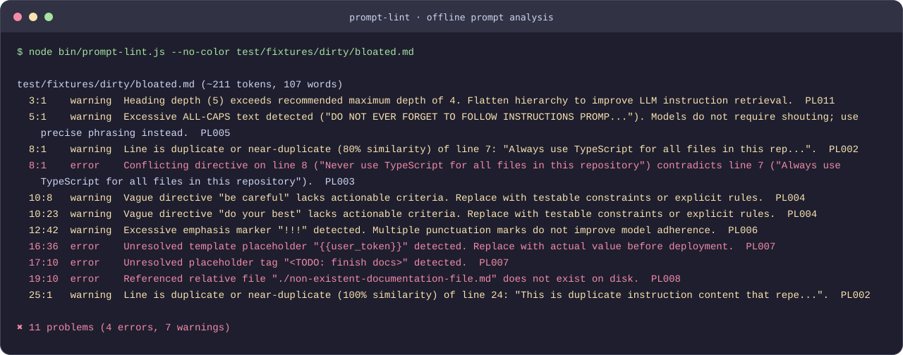

# prompt-lint
[](https://github.com/YusufBeratZengin/prompt-lint/actions/workflows/ci.yml) [](https://www.npmjs.com/package/prompt-lint) [](LICENSE) [](package.json)
[English](README.md) | [Türkçe](README.tr.md)

A local, offline, zero-dependency linter for LLM prompts and agent instructions such as `CLAUDE.md`, `AGENTS.md`, and `.cursorrules`.



## Why prompt-lint?

- Run thirteen deterministic rules locally, with no API keys, network calls, or runtime dependencies.
- Catch contradictions, repeated instructions, unresolved placeholders, broken links, and exposed secrets in one pass.
- Use the same checks in your terminal, ESM code, and CI with JSON or SARIF output.

## Quick start

Requires Node.js 20 or newer and Git. Run directly from source without installing packages:

```bash
git clone https://github.com/YusufBeratZengin/prompt-lint.git
cd prompt-lint
node bin/prompt-lint.js --no-color test/fixtures/clean/CLAUDE.md
```

The clean fixture prints `No problems found` and exits 0. To see diagnostics, run the demo below; this intentionally flawed fixture exits 1.

<details>
<summary>Demo command and full terminal output</summary>

```text
$ node bin/prompt-lint.js --no-color test/fixtures/dirty/bloated.md

test/fixtures/dirty/bloated.md (~211 tokens, 107 words)
  3:1    warning  Heading depth (5) exceeds recommended maximum depth of 4. Flatten hierarchy to improve LLM instruction retrieval.  PL011
  5:1    warning  Excessive ALL-CAPS text detected ("DO NOT EVER FORGET TO FOLLOW INSTRUCTIONS PROMP..."). Models do not require shouting; use precise phrasing instead.  PL005
  8:1    warning  Line is duplicate or near-duplicate (80% similarity) of line 7: "Always use TypeScript for all files in this rep...".  PL002
  8:1    error    Conflicting directive on line 8 ("Never use TypeScript for all files in this repository") contradicts line 7 ("Always use TypeScript for all files in this repository").  PL003
  10:8   warning  Vague directive "be careful" lacks actionable criteria. Replace with testable constraints or explicit rules.  PL004
  10:23  warning  Vague directive "do your best" lacks actionable criteria. Replace with testable constraints or explicit rules.  PL004
  12:42  warning  Excessive emphasis marker "!!!" detected. Multiple punctuation marks do not improve model adherence.  PL006
  16:36  error    Unresolved template placeholder "{{user_token}}" detected. Replace with actual value before deployment.  PL007
  17:10  error    Unresolved placeholder tag "<TODO: finish docs>" detected.  PL007
  19:10  error    Referenced relative file "./non-existent-documentation-file.md" does not exist on disk.  PL008
  25:1   warning  Line is duplicate or near-duplicate (100% similarity) of line 24: "This is duplicate instruction content that repe...".  PL002

✖ 11 problems (4 errors, 7 warnings)
```

</details>

## Installation

To use an npm release in your project:

```bash
npm install --save-dev prompt-lint
```

Use `npx prompt-lint` after installation. The source-checkout commands below use `node bin/prompt-lint.js`; in another project, replace that prefix with `npx prompt-lint`.

## Usage examples

### CLI

With no targets, the linter discovers instruction and prompt files recursively. Explicit file arguments are included even when ignored during discovery.

```bash
node bin/prompt-lint.js
node bin/prompt-lint.js CLAUDE.md AGENTS.md
node bin/prompt-lint.js --format json CLAUDE.md
node bin/prompt-lint.js --format sarif CLAUDE.md
```

Output formats are stylish terminal text, JSON, and SARIF v2.1.0. Colors follow TTY detection, `NO_COLOR`, and `FORCE_COLOR`; `--no-color` disables them explicitly.

### Standard input

```bash
printf 'Run unit tests.\n' | node bin/prompt-lint.js --stdin --stdin-filename system.prompt
```

### API

The ESM API also exports configuration, scanning, rule, and formatter helpers. `lintText` uses built-in defaults unless a config is supplied; load file configuration with `loadConfig` when needed.

```javascript
import { lintText, lintFiles, estimateTokens } from "prompt-lint";

console.log(estimateTokens("Run unit tests before committing."));
const result = lintText("Always use TypeScript.\nNever use TypeScript.");
console.log(result.diagnostics);
const files = await lintFiles(["CLAUDE.md", "AGENTS.md"]);
```

### Options

| Option | Short | Description | Default |
| --- | --- | --- | --- |
| `--format <format>` | `-f` | Output format: `stylish`, `json`, `sarif` | `stylish` |
| `--config <path>` | `-c` | Custom JSON configuration file path | Auto-detected |
| `--max-tokens <count>` | | Override token budget threshold for PL001 | `2000` |
| `--max-warnings <count>` | | Exit with status code 1 if warnings exceed count | `-1` (disabled) |
| `--quiet` | `-q` | Report errors only, suppressing warnings | `false` |
| `--rule <id>=<sev>` | | Override rule severity (`off`, `info`, `warning`, `error`) | None |
| `--ignore <pattern>` | | Exclude glob pattern from linting | None |
| `--stdin` | | Read prompt content from standard input | `false` |
| `--stdin-filename <name>` | | Label displayed when using `--stdin` | `<stdin>` |
| `--no-color` | | Disable ANSI terminal colors | `false` |
| `--version` | `-v` | Display package version | |
| `--help` | `-h` | Display help screen | |

## Exit codes

| Code | Meaning |
| --- | --- |
| `0` | No errors; warnings are within the configured limit (unlimited by default). |
| `1` | Lint errors, warnings exceeding `--max-warnings`, or no files matching explicit targets. |
| `2` | Usage or configuration error. |

`--max-warnings 0` fails on any warning. `--quiet` hides warnings in the report; warning limits still apply.

## Rules

| Rule ID | Name | Category | Default Severity | Description |
| --- | --- | --- | --- | --- |
| `PL001` | `token-budget` | Budget | `warning` | Flags instruction files whose estimated token count exceeds the configured budget. |
| `PL002` | `duplicate-content` | Redundancy | `warning` | Detects duplicate or near-duplicate lines using normalized shingles and Jaccard similarity. |
| `PL003` | `contradictory-directives` | Logic | `error` | Flags conflicting instructions (such as "always X" vs "never X") with matching normalized objects and qualifier scopes. |
| `PL004` | `vague-directive` | Clarity | `warning` | Identifies non-actionable directives like "be careful", "do your best", or "ensure high quality". |
| `PL005` | `shouting-density` | Style | `warning` | Detects excessive consecutive ALL-CAPS words or shouting sentences. Excludes standard acronyms. |
| `PL006` | `excessive-emphasis` | Style | `warning` | Detects repeated punctuation marks (`!!!`, `???`) or stacked markdown bold-italics formatting. |
| `PL007` | `unresolved-placeholder` | Integrity | `error` | Detects unresolved placeholders (`{{var}}`, `<TODO>`, `TBD`, `[INSERT_...]`). |
| `PL008` | `broken-relative-link` | Integrity | `error` | Verifies that relative file paths referenced in backticks or markdown links exist on disk. |
| `PL009` | `exposed-secret` | Security | `error` | Scans for exposed API keys, bearer tokens, or private credentials, masking values in reports. |
| `PL010` | `long-paragraph` | Clarity | `warning` | Flags lines exceeding character limits or dense paragraphs exceeding word limits without breaks. |
| `PL011` | `excessive-heading-depth` | Style | `warning` | Flags markdown heading depths greater than 4 (`#####` and `######`) that fragment context. |
| `PL012` | `list-item-verb` | Style | `off` | Enforces that list items begin with an active imperative verb. (Optional, disabled by default). |
| `PL013` | `section-token-budget` | Budget | `warning` | Flags sections above 1,000 estimated tokens; configure `options.PL013.maxTokens`. |

See the [complete rule reference](docs/rules.md) for why each rule matters, bad/good examples, options, and limitations. PL003 already checks contradictory instructions; PL008 checks dangling file and directory references, including Windows paths and bare filenames in backticks.

## Examples

Compare [CLAUDE.bad.md](examples/CLAUDE.bad.md) with [CLAUDE.good.md](examples/CLAUDE.good.md), using the [example configuration](examples/.promptlintrc.json). The first command exits 1; the second exits 0.

```bash
node bin/prompt-lint.js --config examples/.promptlintrc.json examples/CLAUDE.bad.md
node bin/prompt-lint.js --config examples/.promptlintrc.json examples/CLAUDE.good.md
```

```text
$ node bin/prompt-lint.js --no-color --config examples/.promptlintrc.json examples/CLAUDE.bad.md

examples/CLAUDE.bad.md (~30 tokens, 10 words)
  4:1   error    Conflicting directive on line 4 ("Never use TypeScript") contradicts line 3 ("Always use TypeScript").  PL003
  6:1   warning  Vague directive "Be careful" lacks actionable criteria. Replace with testable constraints or explicit rules.  PL004
  6:11  warning  Excessive emphasis marker "!!!" detected. Multiple punctuation marks do not improve model adherence.  PL006

✖ 3 problems (1 error, 2 warnings)
```

## Configuration

Configuration is read from `.promptlintrc.json`, `.promptlintrc`, or the `promptlint` field of `package.json` in the working directory, in that order. Use `--config` for an explicit file.

```json
{
  "$schema": "https://raw.githubusercontent.com/YusufBeratZengin/prompt-lint/main/schema.json",
  "budget": { "maxTokens": 2000 },
  "rules": { "PL003": "error", "PL012": "off" },
  "options": {
    "PL002": { "threshold": 0.8, "minWords": 4 },
    "PL013": { "maxTokens": 1000 }
  },
  "ignore": ["generated/**"]
}
```

[JSON Schema](schema.json) supports editor validation. Unknown top-level keys, unknown rule IDs, and invalid severities fail with exit code 2 and name the configuration file and offending key. Rule IDs and severity strings are case-insensitive. Severities are `off`, `info`, `warning`, and `error`; legacy aliases `0`/`false`, `1`, and `2`/`true` mean off, warning, and error. Ignore patterns extend the defaults.

## How it works

The linter parses Markdown lines, estimates token usage, runs thirteen deterministic static rules, and formats diagnostics. Rules have no network calls. PL003 compares opposing English directives only when normalized objects and qualifier tails match, including two empty tails; differing scopes are left unreported. Its legacy `threshold` option remains accepted but no longer changes this exact-match heuristic. PL013 counts each heading's body up to the next heading of any depth, including fenced content; preamble text is a separate section. It is independent of the whole-file PL001 budget.

## FAQ and limitations

### Does analysis send prompts to a service?

Analysis runs locally and does not upload prompts. Secret diagnostics mask the matched value, but reports can contain other prompt text and file paths. Review reports before sharing them.

### Are token counts exact, and which languages are supported?

Token counts are heuristic estimates, not a tokenizer. Accuracy varies with text and model; use the target model's tokenizer for exact budgets. Static rules can miss semantic contradictions or flag valid instructions. Language-based rules primarily recognize English.

### Can I use it if npm cannot find the package?

Yes. The [Quick start](#quick-start) uses the source checkout and needs no package installation. The npm badge reflects the registry and may be unavailable before publication.

### Why does the demo exit with status 1?

It intentionally includes lint errors. Use the clean fixture to verify setup. See [Exit codes](#exit-codes) for CI behavior and warning limits.

## GitHub Action

After checking out your repository, use the composite Action directly from source. It sets up Node.js 22 and needs no npm installation. `@main` works before a release; pin a reviewed commit SHA for reproducible builds. The Action is read-only with respect to your source files; reports are written under the runner's temporary directory.

```yaml
name: Prompt quality
on: [push, pull_request]
permissions:
  contents: read
jobs:
  lint:
    runs-on: ubuntu-latest
    steps:
      - uses: actions/checkout@v4
      - uses: YusufBeratZengin/prompt-lint@main
        with:
          paths: |
            AGENTS.md
            prompts/**/*.prompt.md
          fail-on: warning
```

| Input | Default | Meaning |
| --- | --- | --- |
| `paths` | Empty | One file, directory, or glob per line, relative to the checkout. Empty uses automatic discovery. Spaces within a path are preserved; shell quoting is unnecessary. |
| `config` | Empty | JSON config path relative to the checkout. Empty uses normal config discovery. |
| `format` | `stylish` | `stylish`, `json`, or `sarif`. |
| `fail-on` | `error` | `error` fails on errors; `warning` fails on warnings or errors; `none` reports findings without failing. |

Configuration, unreadable-file, and target discovery failures still fail with `fail-on: none`. Outputs: `report` is the absolute report path; `exit-code` is the original lint exit code. Reports are available even when findings fail the step. Auto-discovery with no files produces an empty structured report. Explicit targets with no matches fail. Paths are passed as data without shell evaluation. The [self-test workflow](.github/workflows/action-test.yml) exercises Linux and Windows and validates SARIF against the OASIS schema.

## GitHub code scanning (SARIF)

Use this workflow in repositories where code scanning is enabled. It grants the upload step `security-events: write` and uploads the report even when lint findings fail the preceding step:

```yaml
name: Prompt code scanning
on: [push, pull_request]
permissions:
  contents: read
  security-events: write
jobs:
  scan:
    runs-on: ubuntu-latest
    steps:
      - uses: actions/checkout@v4
      - uses: YusufBeratZengin/prompt-lint@main
        id: lint
        with:
          format: sarif
          fail-on: error
      - uses: github/codeql-action/upload-sarif@v4
        if: ${{ !cancelled() && steps.lint.outputs.report != '' }}
        with:
          sarif_file: ${{ steps.lint.outputs.report }}
          category: prompt-lint
```

SARIF v2.1.0 output uses repository-relative, URI-encoded paths, an explicit source root, matching rule indices, and UTF-16 columns. The upload action can generate fingerprints from the checked-out source. See [GitHub SARIF requirements](https://docs.github.com/en/code-security/reference/code-scanning/sarif-files/sarif-support). Repository permissions and fork pull-request policies can limit uploads. Analysis itself stays local; uploading a report sends diagnostic text and paths to GitHub. Use local reports when instructions contain private data.

## pre-commit framework

Add this to your project's `.pre-commit-config.yaml`. The framework installs the hook from source using `language: node`; no published npm package is required. `rev: main` is usable before a release; pin a reviewed commit SHA for reproducibility.

```yaml
repos:
  - repo: https://github.com/YusufBeratZengin/prompt-lint
    rev: main
    hooks:
      - id: prompt-lint
```

With [pre-commit](https://pre-commit.com/) installed, run:

```bash
pre-commit install
pre-commit run prompt-lint --all-files
```

The hook checks changed instruction/prompt files, including Cursor `.mdc` rules, and fails on warnings or errors. Node.js 20 or newer is required; pre-commit manages its Node environment, and `language_version` can select a specific compatible version. Config is read from your project. To check additional filenames, override the hook's `files` regex. To allow warnings, set `args: [--]`; to select a config, use `args: [--config, .promptlintrc.json, --max-warnings, '0', --]`.

### Plain Git hook

In a source checkout, place this script in `.git/hooks/pre-commit` and make it executable on POSIX systems. It checks instruction files in the working tree. In a consuming project, install the dev dependency above and use `npx --no-install prompt-lint --max-warnings 0` instead.

```sh
#!/bin/sh
node bin/prompt-lint.js --max-warnings 0 || exit 1
```

## Development

From a source checkout:

```bash
npm ci
npm run lint
npm test
npm run demo:check
npm pack --dry-run
```

Tests use `node:test` without network access. `npm test` prints native Node.js line, branch, and function coverage in the terminal and CI. CI covers Node.js 20, 22, and 24 on Windows and Linux; CodeQL analyzes JavaScript on pushes, pull requests, and a weekly schedule.

Regenerate the terminal image with `npm run demo`; `npm run demo:check` verifies that the committed image matches current CLI output. The project ships JavaScript and has no separate typecheck command.

## Contributing

See [CONTRIBUTING.md](CONTRIBUTING.md) for setup, rule development, commit style, and releasing. Report vulnerabilities privately as described in [SECURITY.md](SECURITY.md). Community participation follows the [Code of Conduct](CODE_OF_CONDUCT.md).

## License

[MIT](LICENSE). Copyright (c) 2026 Yusuf Berat Zengin.
